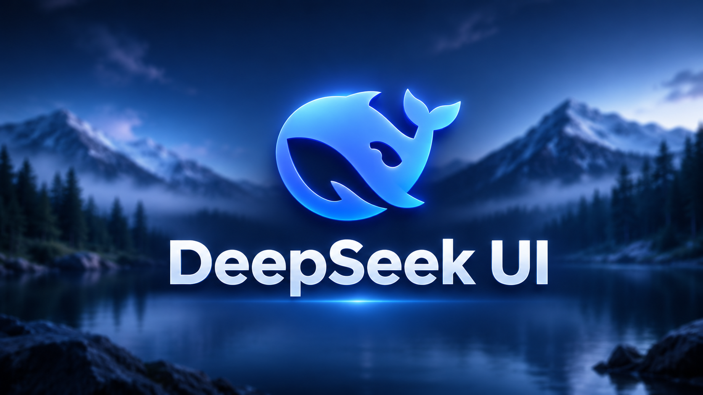

<div align="center">



# 🚀 DeepSeek V4.1-Flash
**The Ultimate Premium UI Library for Roblox.**

[](https://github.com/WareSploit/DeepSeek-V4.1-Flash-Library)
[](https://luau.org/)
[]()
[]()

</div>

---

## 📖 About
**DeepSeek V4.1-Flash** is a modern, highly customizable UI library designed for Roblox exploits. It features smooth animations, multi-window support, dynamic columns, and a built-in theme engine.

### ✨ Features
- 🎨 **4 Built-in Themes** (Blue, Red, Green, Dark) with instant switching.
- 📐 **Dynamic Columns:** Add up to 5+ columns per tab (`Tab:AddColumn()`).
- 🪟 **Multi-Window Support:** Spawn as many independent menus as you want.
- ⚙️ **Full Element Suite:** Toggle (with sub-toggles), Slider, Dropdown (Multi/Search), Keybind (Toggle/Hold/Always), ColorPicker (Alpha), TextBox, and Button.
- 💾 **Config System:** Save/Load/Delete configurations securely.
- 🔔 **Advanced Notifications:** Info, Success, Warning, and Error states.
- 🖱️ **Smooth Dragging:** Fully draggable OpenFrame and MainFrame.

---

## ⚡ Quick Start

Load the library using `loadstring`:

```lua
local Library = loadstring(game:HttpGet("https://raw.githubusercontent.com/WareSploit/DeepSeek-V4.1-Flash-Library/main/main.lua"))()

local Window = Library:CreateWindow({
    Title = "DeepSeek V4.1-Flash"
})

local Tab = Window:AddTab("Main", Library.Icons.crosshairs)
local Col = Tab:AddColumn(205)
local Section = Col:AddSection("Aimbot", Library.Icons.feather)

Section:AddToggle({
    Name = "Enabled",
    Default = true,
    Flag = "aim_enabled",
    Callback = function(state)
        print("Aimbot:", state)
    end
})

Library:Notify({
    Title = "Loaded",
    Text = "Welcome to DeepSeek!",
    Type = "Success"
})
